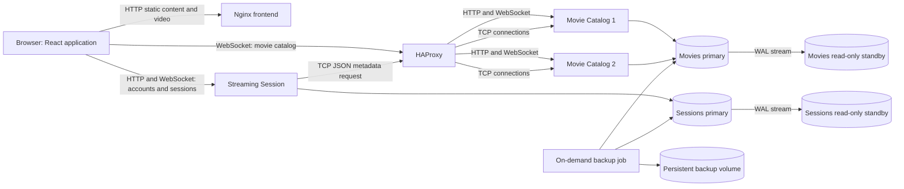

# Netflix-Inspired Distributed Streaming Platform

## Project overview

This project is an academic prototype of a distributed video-streaming application. It combines a
React and TypeScript browser client, Django application services, HAProxy, and PostgreSQL. The
prototype demonstrates service separation, HTTP and WebSocket communication, a newline-framed TCP
protocol, Catalog load balancing, PostgreSQL streaming replication, and logical database backups.

The backend supports account registration and login; the browser application provides login,
movie browsing and details, video playback, per-user playback sessions, and playback-progress
tracking. Account registration is available through the Streaming Session HTTP API, not through a
registration screen in the current frontend. The application includes a Continue Watching view and
lets a user start a new session for a title whose previous session has ended.

This is a local academic system, not a production streaming platform. The video assets are bundled
with the frontend and served as static files. It does not implement an external video CDN, adaptive
bitrate streaming, distributed caching, event messaging, or automatic database failover.

## Goals and scope

The project keeps the movie catalog and playback-session responsibilities in separate Django
services and stores their data in separate PostgreSQL databases. It demonstrates the following
distributed-systems properties:

1. **Resilient service-to-service TCP calls:** the Streaming Session service retrieves movie
   metadata from the Catalog using framed JSON requests, timeouts, bounded retries, and a
   process-local circuit breaker.
2. **Catalog process availability:** HAProxy balances Catalog HTTP and TCP traffic between two
   instances and removes unhealthy instances from service.
3. **Database copies and restore points:** each PostgreSQL primary streams WAL to a read-only
   replica, and an on-demand job creates logical backups of both primaries.

These mechanisms have deliberately limited failure domains. HAProxy can route around a failed
Catalog process, but both Catalog instances depend on the same Movies primary. PostgreSQL replicas
receive changes asynchronously and are not promoted automatically. The backup job runs only when
invoked.

## Technology and runtime

| Area | Technology | Responsibility |
| --- | --- | --- |
| Browser application | React, TypeScript, Vite build | Login, browsing, details, playback, and progress UI |
| Static web server | Nginx | Serves the built single-page app and local video assets |
| Application services | Django, Django REST Framework, Django Channels, Daphne | Catalog HTTP/WebSocket APIs and Streaming Session APIs |
| Catalog proxy | HAProxy | HTTP/WebSocket and raw TCP routing to Catalog instances |
| Data stores | PostgreSQL 16 | Separate Movies and Sessions primary databases |
| Replication | PostgreSQL physical streaming replication | Asynchronous read-only standby for each primary |
| Container runtime | Docker Compose | Local service network, startup ordering, health checks, and named volumes |

The Python dependency list is in `requirements.txt`; frontend dependencies are declared in
`frontend/package.json` and `frontend/package-lock.json`. The project has no Redis, RabbitMQ, or
dedicated Search Service. Catalog filtering is performed by the Catalog application against
PostgreSQL.

## Architecture

### Components

- **Frontend:** A React single-page application with login, movie browsing, movie details, playback,
  Continue Watching, and Watch Again flows. The Vite build is served by Nginx. Nginx serves video
  files from the frontend's static content and supports byte-range responses used for seeking.
- **Movie Catalog:** Two instances of the same Django application. They expose movie-list,
  movie-detail, health, and WebSocket interfaces and accept metadata requests over TCP. Both
  instances use the Movies primary.
- **HAProxy:** Has separate frontends for Catalog HTTP/WebSocket traffic and Catalog TCP traffic.
  HTTP health checks call `/health/`; TCP health checks verify that the backend port accepts a
  connection.
- **Streaming Session:** A Django service that owns account authentication and playback-session
  records. It exposes HTTP endpoints and a session WebSocket. It requests movie metadata through
  HAProxy's TCP frontend when creating a session.
- **Movies PostgreSQL pair:** The primary owns movie metadata. Its physical standby follows the
  primary's WAL stream and is configured read-only.
- **Sessions PostgreSQL pair:** The primary owns Django users and playback sessions. Its physical
  standby follows the Sessions primary and is configured read-only.
- **Backup job:** An on-demand Compose service that writes compressed logical dumps of both primary
  databases to the persistent `postgres_backups` volume.

### Service relationships

All services join the Compose bridge network and address each other by Compose service name. The
browser uses published host ports. Catalog WebSocket connections use HAProxy's HTTP frontend;
WebSocket begins as HTTP and is upgraded by the application server. The Streaming Session
WebSocket is published directly by that service.

### Main request flows

1. The browser downloads the application bundle from Nginx. Video playback requests target the
   relative URL stored on a movie record, such as `/videos/example.mp4`.
2. The browser requests Catalog data through Catalog WebSocket operations, with Catalog HTTP list
   and detail endpoints also available. HAProxy selects a healthy Catalog instance.
3. Registration is available through the Streaming Session HTTP API. The browser login screen
   sends login requests to that service. A successful login returns a signed token used to
   authenticate the session WebSocket.
4. The session WebSocket associates each playback session with the authenticated user. On session
   creation, Streaming Session looks up the selected movie's metadata using the Catalog TCP API,
   then stores the session in the Sessions database.
5. Playback progress and state changes are sent through the session interface and persisted. The
   frontend uses the resulting session state for Continue Watching and Watch Again behavior.

## Catalog TCP protocol and resilience

The Streaming Session service calls the Catalog using TCP through HAProxy. A request is one UTF-8
JSON object containing an operation and movie identifier, followed by a newline. The Catalog reads
through the newline, parses the complete request, and returns a newline-terminated JSON response.
The TCP server enforces a 64 KiB request-frame limit; the client limits response frames to 1 MiB.

TCP is a byte stream, so the request or response may arrive over multiple socket reads. The client
accumulates response fragments until a newline is received. An empty, malformed, oversized, or
unframed response is treated as an error. The server handles malformed and invalid requests per
connection, logs them, and continues accepting other connections. A peer that connects and closes
without sending a frame is treated as an empty health probe and closed quietly.

The client applies a socket timeout to connection and response operations. When a call fails due to
connection error, timeout, or protocol error, it retries up to the configured retry count; the
initial call is additional, so the default of three retries permits up to four attempts. Delays use
exponential growth and jitter and are capped at two seconds. A movie-not-found response is an
application result and is not retried. After retries are exhausted, the application receives an
unavailable result rather than an uncaught transport exception.

The circuit breaker tracks operations after their retries are exhausted. With default settings, five
failed operations open the breaker for 30 seconds. After the recovery interval, at most one
half-open probe is admitted. A successful probe closes the breaker; a failed probe reopens it. The
timeout, retry count, backoff base, failure threshold, recovery interval, and half-open limit can be
configured with the `MOVIE_CATALOG_TCP_*` environment variables.

The breaker is process-local to Streaming Session. HAProxy's health state is separate: it excludes
unhealthy Catalog backends from routing. TCP reads performed for metadata are safe to retry because
they do not modify Catalog data. Neither mechanism provides database failover.

## Catalog load balancing and health

HAProxy uses round-robin balancing for both Catalog frontends. Its HTTP check requests `/health/`
and expects status 200. That endpoint verifies database reachability, so a shared Movies primary
problem can make both Catalog instances unhealthy. The TCP check verifies backend connection
acceptance only; it does not send a JSON application request. Normal TCP clients must still send a
newline-framed request.

Checks run every two seconds, with two failures marking a backend down and two successful checks
allowing it to rise again. Once marked down, that Catalog instance is removed from rotation while
the other healthy instance serves traffic. After recovery, successful checks restore the instance
to the pool. The two Catalog processes provide application-process redundancy, not independent
database redundancy.

## Application and data model

### Movie Catalog data

Each movie record contains a title, description, genre, duration in seconds, release date, and video
URL. The title is unique. The Catalog's HTTP routes include `/api/movies/` and
`/api/movies/<id>/`; `/health/` reports Catalog and Movies database health. WebSocket operations
support interactive listing and detail retrieval. Catalog reads are public, while protected write
operations require a staff authorization claim.

The movie fixtures provide the initial catalog content. The video URL is a path served by Nginx,
not a stream proxied from the Catalog. Nginx handles media byte ranges so compatible browsers can
seek within a video. A missing local file returns 404.

### Accounts and playback sessions

The Streaming Session service uses Django's user model. Registration is provided through its HTTP
API and applies the configured password validators; the frontend currently provides login but no
registration screen. Login returns a signed JWT. Session records contain the owning user, movie
identifier, movie duration, playback position, state (`playing`, `paused`, or `ended`), timestamps,
and a version counter. The movie identifier is stored as an application-level reference; it is not
a cross-database foreign key to the Movies database.

Session list and update operations are scoped to the authenticated owner. Session creation obtains
the movie duration through the Catalog TCP interface. Progress updates can be reflected in the
frontend's Continue Watching view. When a title has ended, playing it again creates a new session
rather than reopening the completed record.

HTTP routes include `/api/register/`, `/api/login/`, `/api/sessions/`, and
`/api/sessions/<id>/`. The session WebSocket is available at `/ws/sessions/`. Health endpoints are
available at `/health/` on the application services.

## Database replication and backup

Movies and Sessions each have their own PostgreSQL primary and physical streaming standby. Each
standby runs in recovery/read-only mode and replays WAL from its corresponding primary. Changes are
replicated asynchronously, so a short delay before a commit appears on the replica is expected.
Applications write to their respective primaries; replicas are not used as automatic write targets.

There is no automated database promotion, leader election, or application connection switching.
If a primary becomes unavailable, the project does not automatically promote its standby. A
replica is a recovery copy, not a failover guarantee, and asynchronous replication can lag.

The Compose `backup` profile contains a one-shot job that uses PostgreSQL logical dumps to back up
both primaries. Output is compressed and stored in the named `postgres_backups` volume. Backups are
on demand; no schedule, retention policy, or automatic restore is configured. A safe restore test
uses a separate temporary database, checks representative restored records, and drops only that
temporary database afterward. Replication and logical backups address different recovery needs.

## Configuration and security boundaries

Compose settings can be overridden through the existing `.env` file. Configuration groups include
database names, users and passwords (`MOVIE_DB_*`, `SESSION_DB_*`), Django keys and debug/host
settings (`DJANGO_*` and service-specific secret variables), JWT signing, TCP resilience settings,
and host ports. `.env.example` documents development defaults. Never commit real credentials or
replace an existing environment file with defaults.

The checked-in configuration is intended for trusted local development. It supplies development
fallback values when variables are omitted and enables Django debug behavior by default. Before
exposing the application to an untrusted network, configure unique secrets, disable debug, set
specific allowed hosts and origins, and review database and application port exposure. Database
host ports are bound to loopback by default; the frontend and application/proxy ports use the
configured Compose host bindings.

JWTs authenticate account and session operations. Catalog reads are publicly available. Catalog
write operations are restricted by staff authorization claims. Database credentials are passed to
containers through environment configuration; they should be treated as secrets even though the
local development defaults are not suitable for deployment.

## Host interfaces and service ports

Default host ports are configurable in Compose and may differ when overridden:

| Interface | Default host port | Purpose |
| --- | ---: | --- |
| Frontend / Nginx | 3000 | Browser application, static assets, and local videos |
| Catalog HTTP and WebSocket / HAProxy | 8000 | Balanced Catalog HTTP and upgraded WebSocket traffic |
| Catalog TCP / HAProxy | 9002 | Balanced newline-framed JSON TCP requests |
| Streaming Session HTTP and WebSocket | 8001 | Registration, login, session APIs, and session socket |
| Movies primary PostgreSQL | 5434 | Local database inspection and administration |
| Movies replica PostgreSQL | 5444 | Local read-only replica inspection |
| Sessions primary PostgreSQL | 5435 | Local database inspection and administration |
| Sessions replica PostgreSQL | 5445 | Local read-only replica inspection |

Inside the Compose network, PostgreSQL uses port 5432; Catalog HTTP and TCP use ports 8000 and
9002. Containers connect by service name. Published host port changes do not change internal
service-to-service addresses.

## Source layout

| Path | Contents |
| --- | --- |
| `frontend/` | React/TypeScript application, Nginx configuration, and bundled video assets |
| `movie_catalog_microservice/` | Catalog Django project, movie model/API, WebSocket consumer, and TCP server |
| `streaming_session_microservice/` | Session Django project, authentication, session model/API, and TCP client |
| `docker-compose.yml` | Services, networks, health checks, profiles, ports, and persistent volumes |
| `haproxy.cfg` | Catalog HTTP and TCP frontends, balancing, and backend checks |
| `docker/` | Database initialization, replication setup, and logical backup scripts |
| `postgres_movies_hba.conf` | Movies database connection and replication access rules |
| `postgres_sessions_hba.conf` | Sessions database connection and replication access rules |
| `requirements.txt` | Python application dependencies |
| `README.md` | Project architecture and implementation description |
| `Installation_Guide.txt` | Separate environment setup and installation instructions |
| `Usage_Manual.txt` | Separate user and operator workflows |

## Verification and limitations

The repository includes Django test suites for Catalog and Streaming Session behavior. The suites
cover application APIs and the implemented TCP client/server behavior, including framing, timeout,
retry, and circuit-breaker cases. Live container checks are needed to demonstrate actual HAProxy
distribution and recovery, PostgreSQL replication/read-only behavior, and backup restoration.
These are different forms of evidence and should be reported separately.

Backend HTTP success does not prove every browser flow. Login, browsing, playback, seeking, progress
updates, Continue Watching, and Watch Again should be checked through the actual UI when claiming
end-to-end browser verification. Media playback also depends on the selected local asset existing
and being reachable from Nginx.

The design does not include automatic database failover, cross-region replication, a distributed
circuit breaker, service discovery beyond the Compose network, a message broker, an external search
index, or a CDN. Catalog instance health cannot protect against failure of the shared Movies
primary, and a successful health check is not a guarantee of application-level correctness for
every request.

## Related project documents

Environment setup and installation steps are maintained separately in `Installation_Guide.txt`.
User-facing and operator testing workflows are maintained separately in `Usage_Manual.txt`; they
are intentionally not duplicated here.
